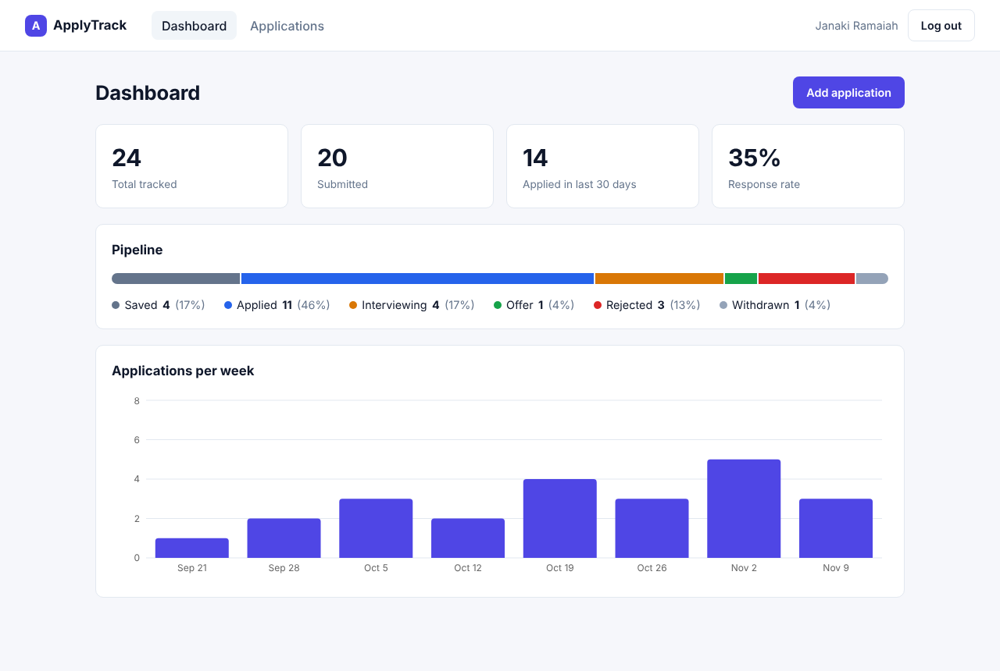
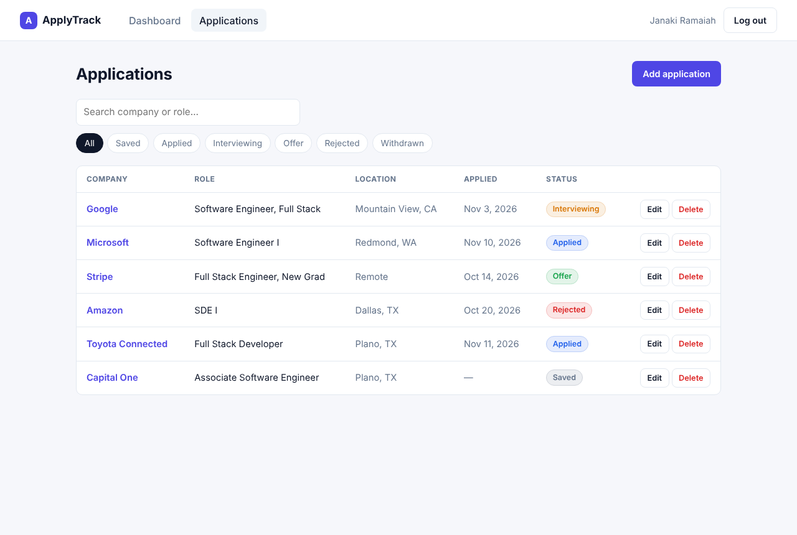

# ApplyTrack

A full-stack web app for tracking job applications from **saved → applied → interviewing → offer**, with a dashboard that shows your pipeline, weekly activity and response rate.

Built with **Spring Boot 3 (Java 17)**, **React 19**, **PostgreSQL**, **JWT authentication**, **Docker** and **GitHub Actions CI**.



## Features

- **Accounts with JWT auth.** Register and log in; passwords are hashed with BCrypt. The API is stateless: every request carries a signed token.
- **Application tracking.** Create, edit and delete applications with company, role, location, job link, status, date applied and notes.
- **Fast status changes.** Click a status badge in the list to move an application to the next stage.
- **Search, filter and pagination.** Search by company or role and filter by status, all handled server-side with paged results.
- **Dashboard.** Totals, applications in the last 30 days, response rate, a pipeline breakdown and an 8-week activity chart.
- **Data isolation.** Every query is scoped to the signed-in user, so one user can never read or change another user's data (covered by tests).
- **Validation on both sides.** The React form and the Spring API enforce the same rules; the API returns field-level error messages.



## Architecture

```
React (Vite) ──/api──▶ Spring Boot REST API ──JPA/Hibernate──▶ PostgreSQL
   │                       │
   └ nginx in Docker        └ Spring Security + JWT filter
```

| Layer | Tech |
|---|---|
| Frontend | React 19, React Router, Recharts, Vite, Vitest + Testing Library |
| Backend | Spring Boot 3.3, Spring Web, Spring Data JPA, Spring Security, Bean Validation, jjwt |
| Database | PostgreSQL 16 (H2 in-memory for local dev and tests) |
| DevOps | Docker multi-stage builds, Docker Compose, GitHub Actions |

**Backend packages** (`backend/src/main/java/com/applytrack`):

- `auth`: register and login endpoints, token issuing
- `security`: JWT service, request filter, security rules
- `application`: entity, repository, JPA Specifications for filtering, service, controller, stats calculation
- `user`: user entity and repository
- `common`: global exception handler (consistent JSON errors), shared exceptions

## REST API

All `/api/applications` endpoints require `Authorization: Bearer <token>`.

| Method | Endpoint | Description |
|---|---|---|
| POST | `/api/auth/register` | Create an account, returns a JWT |
| POST | `/api/auth/login` | Log in, returns a JWT |
| GET | `/api/applications?status=&q=&page=&size=` | Paged list with filter and search |
| GET | `/api/applications/{id}` | One application |
| POST | `/api/applications` | Create |
| PUT | `/api/applications/{id}` | Update |
| PATCH | `/api/applications/{id}/status` | Change status only |
| DELETE | `/api/applications/{id}` | Delete |
| GET | `/api/applications/stats` | Dashboard numbers |

Errors use one shape:

```json
{ "status": 400, "message": "Validation failed", "errors": { "company": "must not be blank" }, "timestamp": "…" }
```

## Running it locally

### Option 1: Docker (whole stack, one command)

```bash
docker compose up --build
```

Open http://localhost:3000.

### Option 2: Run each part yourself

Requirements: Java 17+, Maven, Node 20+.

```bash
# Terminal 1: API on http://localhost:8080 (uses an in-memory database)
cd backend
mvn spring-boot:run

# Terminal 2: React dev server on http://localhost:5173 (proxies /api to the backend)
cd frontend
npm install
npm run dev
```

## Tests

```bash
cd backend && mvn test     # JUnit 5 + MockMvc integration tests + unit tests
cd frontend && npm test    # Vitest + React Testing Library
```

Backend tests cover registration, login, bad credentials, validation errors, unauthenticated access, full CRUD, filtering, search, pagination, status updates, per-user data isolation, JWT signing and expiry, and the dashboard math.

## Configuration

| Variable | Default | Purpose |
|---|---|---|
| `SPRING_PROFILES_ACTIVE` | (none, H2) | Set to `prod` to use PostgreSQL |
| `DB_URL`, `DB_USERNAME`, `DB_PASSWORD` | local Postgres | Database connection (prod profile) |
| `JWT_SECRET` | dev-only value | Token signing key, at least 32 characters. **Always set in production.** |
| `JWT_EXPIRATION_MINUTES` | 1440 | Token lifetime |

## Roadmap

- Deploy to AWS (backend on Elastic Beanstalk or ECS, database on RDS, frontend on S3 + CloudFront)
- Database migrations with Flyway
- Interview rounds and reminders per application
- Resume version tracking per application
